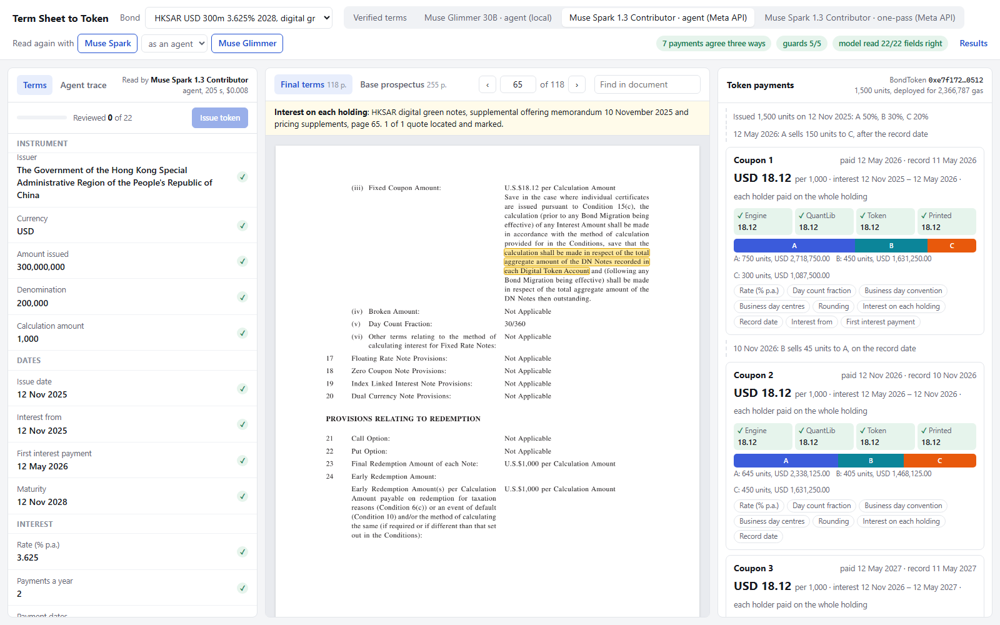

# Term Sheet to Token

[](https://github.com/NiceLeader/term-sheet-to-token/actions/workflows/ci.yml)

A tokenized bond pays its investors through code, but what it owes them is written in legal
documents. The final terms of a note are a few pages long and point to definitions in a base
prospectus of a hundred pages or more: the day count fraction, the business day rules, the
record date, how amounts are rounded. Today those terms are keyed into issuance platforms by
hand, and a wrong digit becomes a wrong payment to every holder.

Term Sheet to Token reads the final terms together with the base prospectus using Meta's Muse
models, resolves the cross-references, and fills a schema aligned with the ICMA Bond Data
Taxonomy, with a quote and a page for every field. It then deploys a bond token configured
from those terms, runs the whole life of the bond on a local chain (issue, transfers around
record dates, every coupon, redemption) and checks each payment against an independent QuantLib
calculation and against the amounts printed in the documents. A reviewer sees every term next
to the highlighted sentence it came from, and every payment next to the clauses it follows from,
approves or corrects each term, and issues the token only when all of them are reviewed and the
replay raises no red flag.



Built for the Meta Global AI Developer Hackathon, October to November 2026.

## How Meta's models are used

| Model | Where it runs | What it does |
|---|---|---|
| Muse Spark | Meta Model API (Responses API) | Reads the documents of a bond in two ways: in one pass, with all documents in context and a strict JSON schema for the answer, or as an agent that calls four tools (`list_documents`, `search`, `read_page`, `submit_terms`) until its submission passes validation. |
| Muse Glimmer | Open weights on the reviewer's own machine, through a local chat completions server (LM Studio or llama.cpp) | The same agent, for documents that should not leave the building. On a single RTX 5090 it reads a bond in under four minutes. |

Every field the model returns carries the quote it relied on and the page of the document,
both where the value is stated (the final terms) and where the term is defined (the base
prospectus). Nothing the model says is trusted without a check:

1. **Quote check.** Each quote must appear on the page it cites. Quotes are compared word by
   word; a near match is accepted only if every number in it is unchanged.
2. **Value check.** The value itself must be written in the quote or on the cited page, in any
   of the ways prospectuses write it (`22nd October, 2029`, `CAD750,000,000`,
   `GBP 1,000 per Specified Denomination` for redemption at 100 per cent).
3. **Consistency checks.** Dates in order, payment dates on the stated cycle, a first interest
   period shorter than two regular periods, denomination dividing the amount issued, printed
   coupon amounts reproduced by the day count fraction and rounding rule, known calendars and
   conventions.
4. **Three-way payment check.** Every coupon and the redemption are computed by the schedule
   engine, by QuantLib, and by the token contract on chain, and compared with the amount
   printed in the documents where there is one.
5. **Holders of record.** Units are moved between three holders the day after one record date
   and on another record date. Who the contract pays is compared with a separate ledger.
6. **Guards.** The contract must reject a payment a minute early, a payment by anyone but the
   paying agent, a second payment of the same coupon, an early redemption, and a redemption
   with a coupon unpaid.

## Results

Twenty-five live fixed-rate bonds from 40 public documents. Eighteen were read while the field
rules were being written: four IBRD notes (EUR, GBP, AUD, CHF; the EUR note is digitally
native), the Hong Kong SAR digital green bonds (USD, EUR, HKD, CNY) and a conventional HKSAR
green bond, and notes of ADB, EIB, CEB, KfW, the Republic of Korea, Toyota Motor Credit, John
Deere Capital and PACCAR Financial. Seven more were fetched, labelled and read after the rules
were frozen: two digitally native EIB notes (EUR on GS DAP, SEK on so|bond), an EIB USD global
note, a CEB euro bond, a NIB USD note and two KfW USD global notes.

| Check | Result |
|---|---|
| Payments where the engine, QuantLib, the token on chain and the printed amounts agree (verified terms) | 205 of 205 |
| Guard probes rejected on chain | 125 of 125 |
| Deliberate bugs planted in the bond contract and caught by replaying the 25 bonds and the contract tests | 18 of 18 |
| Deliberate errors planted in the verified terms that change a cash flow, flagged by the consistency checks before issuance | 290 of 306 |
| Verified values found on the page they are cited from | 299 of 306 |

Reading the documents of the first eighteen bonds (bonds for which the model submitted a full
set of terms, field accuracy of those against the verified terms, bonds whose every payment
comes out right, quotes found on the cited page, time and cost per bond):

| Model and mode | Terms submitted | Field accuracy | All payments right | Quotes on page | Time per bond | Cost per bond |
|---|---|---|---|---|---|---|
| Muse Spark 1.3, agent | 18 of 18 | 99.2% | 18 of 18 | 503 of 530 | 292 s | $0.009 |
| Muse Spark 1.3, one pass | 18 of 18 | 99.7% | 18 of 18 | 473 of 529 | 84 s | $0.015 |
| Muse Glimmer 30B, agent (local) | 15 of 18 | 96.1% | 10 of 15 | 364 of 395 | 222 s | none |

Muse Spark ran on the Contributor tier of the Meta Model API (the same model at a lower price,
in exchange for the inputs being usable for training; the documents are public). Agent mode
costs less than one pass because it reads only the pages it searches for, not the whole
prospectus.

Of 396 values, the single pass got one wrong and agent mode three. Both modes kept London and
Stockholm among the business day centres of the EIB krona note, where the base prospectus says
that once T2 is listed only TARGET days count. Agent mode also took the record date of one Hong
Kong euro bond from the rule for registered notes instead of the rule for the global certificate
held in the clearing system, and wrote the issuer of the KfW note with its seat ("KfW,
Frankfurt/Main, Federal Republic of Germany"). None of these changes the amount or the date of a
payment, so the replay cannot catch them: this is the kind of error the reviewer is there for.

Muse Glimmer, the 30B open-weights model running locally, read fifteen of the eighteen bonds to
the end; for three (Deere, IBRD EUR, Toyota) it never produced a complete set of terms within
its step budget. Of the 330 values it did submit, 317 are right. Its most frequent mistake is to
read "Business Day Convention: Not Applicable" or "not adjusted" as no convention at all,
instead of the payment on the next business day that the conditions provide for; that moves
payment dates, and the consistency checks flag it. Nine of its thirteen wrong values are
flagged before issuance.

The seven bonds fetched and labelled after the field rules were frozen (154 values):

| Model and mode | Terms submitted | Field accuracy | All payments right | Quotes on page | Time per bond | Cost per bond |
|---|---|---|---|---|---|---|
| Muse Spark 1.3, agent | 7 of 7 | 98.1% | 7 of 7 | 184 of 184 | 192 s | $0.006 |
| Muse Spark 1.3, one pass | 7 of 7 | 98.1% | 7 of 7 | 191 of 198 | 90 s | $0.008 |
| Muse Glimmer 30B, agent (local) | 7 of 7 | 98.1% | 7 of 7 | 166 of 166 | 232 s | none |

All three readings miss the same values of the EIB krona note, whose conditions are written
without the usual labels. Its day count is the 30E/360 wording of the ISDA definitions ("without
regard to the date of the first day or last day of the period"), and all three read it as
30/360. Its coupon amounts are rounded "to the nearest SEK (with one half of öre rounded down)",
which none of the five rounding rules expresses; the verified terms carry half up as the nearest
rounding, all three models chose rounding down. The single pass and Glimmer also took the
interest periods as adjusted, because the payment dates are defined "subject to the Following
Business Day Convention", although the coupon is a fixed amount per note. Agent mode of Spark
wrote the KfW issuer with its seat again. None of these changes a payment of the seven bonds;
the day count is flagged by the checks, the others are not. Glimmer completed all seven bonds
within its step budget, against fifteen of eighteen before.

The errors that get through are listed in `tstt mutate terms`: values that are implied rather
than written (redemption at par in a US prospectus that never says "100 per cent", an interest
commencement date given only as "the Issue Date"), a financial centre left out of a list, a
swapped rounding rule where the documents state none, and swaps of the day count or the
business day convention where the cited page is the glossary of the conditions and defines
every option.

## What is in the repository

```
src/tstt/        Python package and the `tstt` command
  fetch.py       download the documents listed in sources/manifest.json, check SHA-256
  docs.py        split PDF and HTML filings into numbered pages
  terms.py       term schema (ICMA Bond Data Taxonomy names) and validation
  schedule.py    payment schedule engine: day counts, calendars, stubs, rounding
  reference.py   the same schedule built independently with QuantLib
  extract.py     one-pass and agent extraction with Meta's models
  llm.py         clients for the Meta Model API and a local chat completions server
  cite.py        quote check;  evidence.py  value check;  checks.py  consistency checks
  token.py       deploy the token on anvil and run the bond's life
  verify.py      the per-bond report
  mutate.py      planted errors in terms and planted bugs in the contract
  eval.py        scoring against the verified terms
  web.py         review screen;  review.py  reviewer sign-off and issuance
contracts/       BondToken.sol and CashToken.sol (Foundry), with tests
eval/groundtruth one file of verified terms per bond, each value with its page
eval/results     score of each extraction run behind the tables above
sources/         manifest of the public documents: URL, size, SHA-256
web/             review screen (plain HTML, CSS and JavaScript)
```

The bond documents themselves are not in the repository; several of them say they may not be
redistributed. `tstt fetch` downloads them from the issuers' and regulators' sites into a folder
outside the repository and checks each file against the manifest.

## BondToken

One contract per bond. The constructor takes the terms (currency, cash token, issuer, paying
agent, units, denomination, calculation amount, rate, frequency, day count fraction, rounding
rule, redemption percentage, whether interest is calculated on each holding) and the schedule
(accrual segments and payment dates with record dates), all as data. The contract then:

- computes each coupon itself from the day count fraction (Actual/Actual ICMA, 30/360,
  30E/360, Actual/365 Fixed, Actual/360, RBA Bond Basis, Actual/Actual Canadian compound) as
  an exact fraction over the segments of the period,
  and rounds once per calculation amount with the rule from the documents, or once per
  holding where the documents calculate interest on each holder's whole holding (the Hong
  Kong digital bonds, on each Digital Token Account);
- pays the holders of record at the close of the record date, from balance checkpoints, so a
  sale after the record date does not move the coupon;
- lets only the paying agent pay, not before the payment date, and only once;
- redeems at maturity only after the last coupon is paid, and burns the units.

## Running it

Requirements: Python 3.12 or later with [uv](https://docs.astral.sh/uv/), and
[Foundry](https://book.getfoundry.sh/) for `forge` and `anvil`.

```sh
uv sync
cp .env.example .env              # set TSTT_DATA_DIR, MODEL_API_KEY, SEC_USER_AGENT
uv run tstt fetch                 # download the public documents (about 21 MB)
uv run tstt parse
forge test --root contracts

uv run tstt verify                # deploy and replay all 25 bonds from the verified terms
uv run tstt extract ibrd-gbp-0750-2026 --model hosted --mode agent
uv run tstt verify ibrd-gbp-0750-2026 --extraction <data dir>/runs/extractions/agent-muse-spark-1.3-contributor
uv run tstt extract --held-out    # the seven bonds read after the field rules were frozen
uv run tstt mutate                # planted errors and planted contract bugs
uv run tstt eval                  # score every extraction run
uv run tstt serve                 # review screen on http://127.0.0.1:8000
```

For the local model, load Muse Glimmer in LM Studio (or `llama-server`), set `LOCAL_API_BASE`
and `LOCAL_MODEL`, and pass `--model local`.

On the review screen each term is approved or corrected (keys: A approves and moves on, J and K
move down and up). Corrections to a model's reading are kept beside the run, so the run can still
be scored; on the verified terms they are written into `eval/groundtruth`, and the file is marked
verified once every term is reviewed and the bond replays cleanly.

The review screen listens on 127.0.0.1 only. It answers only requests addressed to localhost
and accepts a POST only from its own page, so a page on another site cannot start an
extraction that spends API credit.

Every hosted response is recorded with its cost in `<data dir>/runs/spend.jsonl`. Once the
total reaches `MODEL_SPEND_LIMIT_USD`, no further request is sent, from the command line or the
review screen; the limit on the billing page only sends a notification.

## Related work

Reading bond documents with models is not new. The World Bank Treasury extracts fields from
final terms and compares them with vendor data through the ICMA Bond Data Taxonomy, and a person
approves the result ([EuroFinance, February 2026](https://www.eurofinance.com/news/dressing-the-wires-of-the-world-bank-groups-bond-operations-using-ai/)).
Origin Markets extracts term sheet data with machine learning, and the Deutsche Bundesbank checks
collateral eligibility criteria in prospectuses with a language model
([arXiv 2606.27316](https://arxiv.org/abs/2606.27316)). These stop at the data: none of them
configures a token or follows the payments.

The opposite route starts from data. In the DZ BANK and KfW Smart Bond Contract pilot (March
2026) the term sheet is an ICMA Bond Data Taxonomy record stored in the contract, and the legal
terms are generated from it
([KfW](https://www.kfw.de/Presse-Newsroom/Aktuelles/News/SmartBondContract-Pilot-March2026-DZ-KfW.pdf)).
That works for new issues; the bonds already outstanding exist only as prose.

The closest project is DOS Chain RWA ([github.com/DOS/RWA](https://github.com/DOS/RWA), an entry
in a 2026 hackathon): Qwen extracts the parameters of a prospectus, a person reviews them, and an
ERC-3643 token is deployed. Its README describes no quotes or pages, no payment schedule, and no
coupons computed by the token. Term Sheet to Token is about the check between paper and code: a
quote and a page for every term, a contract that computes each payment itself, and a replay of
the whole bond against QuantLib and the printed amounts.

## Limitations

- Fixed-rate notes only. Floating rate, zero coupon, amortising and callable notes are out of
  scope.
- Record dates defined by a clearing system's business days are computed with the bond's
  payment calendar.
- Where a coupon is calculated on the aggregate outstanding amount, the token rounds per unit
  of the smallest denomination, which can differ by a fraction of a cent per holding.
- Rounding to a cash unit larger than the currency's minor unit (CHF 0.05) is not modelled.
- The verified terms were prepared by hand from the documents and may contain mistakes of
  their own; each value cites its page so it can be checked.
- The field rules given to the models were refined while reading the first eighteen bonds. The
  seven bonds read afterwards are a small set, and their issuers other than NIB (EIB, CEB, KfW)
  also appear among the eighteen, so they test unseen documents more than unseen drafting
  styles.

## Where this goes

The reviewer today is the second person who checks a colleague's keying against the PDF. The
same reading, evidence and replay serve more than a new issue:

- Bonds already outstanding exist only as prose. Reading their documents and comparing the
  result with the terms configured in an existing token or issuance system turns the check
  between paper and code into a control that can run on a whole book of bonds.
- Exporting the terms as an ICMA Bond Data Taxonomy record, for issuance platforms and for the
  comparison with vendor data that treasuries already run.
- A second reading by a different model, with the disagreements shown to the reviewer next to
  the flags of the consistency checks: two independent readers make different mistakes.
- Floating-rate, callable and amortising notes: more fields and the fixings of a reference
  rate, the same quotes and the same replay.
- A fully local installation, Muse Glimmer with a local chain, for institutions that cannot send
  documents outside, with the accuracy gap to the hosted model measured as here.

## License

Apache License 2.0, see `LICENSE`.
